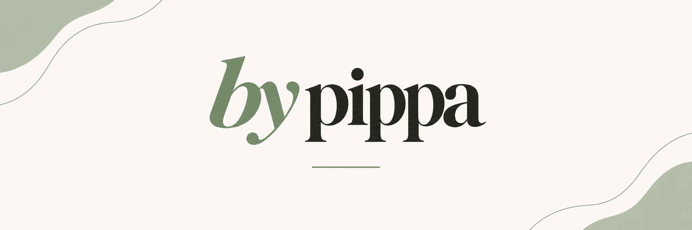

  

   

  *a little corner of the internet where ideas become projects.*

   

  **Software Engineer · curious mind · always creating**

---

### hello, i'm pippa. 🌿

I'm a computer science student exploring the creative side of technology. I enjoy learning by making things, experimenting with ideas, and turning small concepts into working projects.

### selected work

| project | explore |
| :--- | :--- |
| **magic 8 ball** — a playful little project | [view repository](https://github.com/pippa28/Magic8Ball) |
| **quote generator** — a project built around words and inspiration | [view repository](https://github.com/pippa28/QuoteGenerator) |
| **ace canine links** — a links-focused project | [view repository](https://github.com/pippa28/ace-canine-links) |

### currently

- learning, building, and refining my skills
- making my projects more thoughtful and polished
- finding the balance between good design and good code

---

  made with care ♡ · <a href="https://github.com/pippa28">@pippa28</a>

